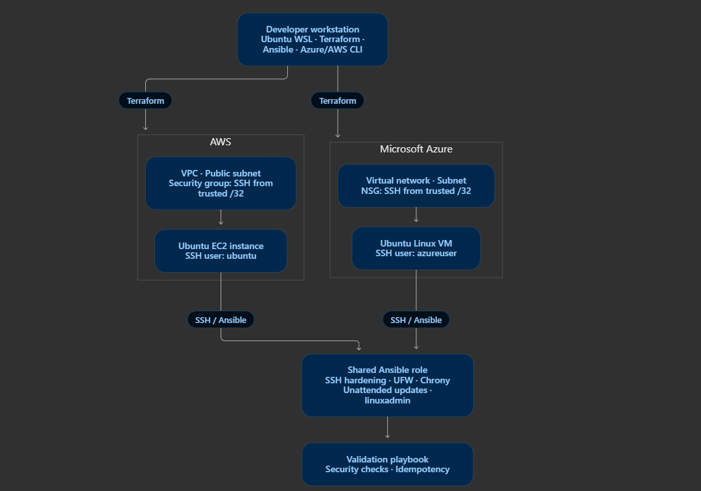

# Automated Linux Server Hardening with Ansible

## Overview



This project automates a baseline of Linux server security controls using Ansible. The goal is to build a reusable, repeatable hardening role that can be applied to Linux servers in local virtual machines and, eventually, AWS and Azure environments.

The project emphasizes infrastructure automation, secure administration, firewall configuration, automatic security updates, and validation through repeatable Ansible runs.

**Current status:** Local Vagrant deployment validated on Ubuntu Server 22.04 LTS. AWS and Azure deployments are planned extensions.

## Objectives

- Automate Linux security configuration with Ansible.
- Create a dedicated administrative account for server management.
- Enforce SSH key-based authentication.
- Disable SSH root login and password authentication.
- Configure UFW with a default-deny inbound policy.
- Enable unattended package updates and configure automatic reboot behavior.
- Validate the configuration and test Ansible idempotency.
- Prepare a reusable baseline for future cloud deployments.

## Architecture

```text
Administrator Workstation
Ubuntu on WSL2
       |
       | Ansible over SSH
       | Ed25519 public key authentication
       v
Vagrant / VirtualBox
       |
       | Host TCP 2222 -> Guest TCP 22
       v
Ubuntu Server 22.04 LTS
       |
       +-- Dedicated linuxadmin account
       +-- SSH hardening
       +-- UFW firewall
       +-- Unattended security updates
       +-- Automatic reboots explicitly disabled
```

## Technology Stack

- Ubuntu Server 22.04 LTS
- Ubuntu on WSL2
- Vagrant
- VirtualBox
- Ansible Core
- Ansible Vault
- UFW
- OpenSSH
- APT and unattended-upgrades
- Terraform for planned cloud infrastructure deployments

## Repository Structure

```text
linux-server-hardening/
├── ansible/
│   ├── group_vars/
│   ├── inventories/
│   │   ├── vagrant/
│   │   ├── aws/
│   │   └── azure/
│   ├── playbooks/
│   │   └── harden.yml
│   └── roles/
│       └── linux_hardening/
│           ├── defaults/
│           ├── handlers/
│           ├── tasks/
│           └── templates/
├── vagrant/
├── aws/
│   └── terraform/
├── azure/
│   └── terraform/
├── scripts/
├── docs/
└── README.md
```

## Security Controls Implemented

### SSH hardening

- Dedicated administrative account: `linuxadmin`
- Ed25519 public-key authentication enabled
- SSH password authentication disabled
- Direct SSH root login disabled
- SSH daemon configuration validated before deployment
- SSH service reloaded when the managed configuration changes

### Firewall

- UFW enabled
- Default inbound policy: deny
- Default outbound policy: allow
- TCP port 22 allowed for SSH
- IPv4 and IPv6 SSH rules verified

For cloud deployments, SSH access should additionally be restricted by the cloud security group or network security group to a trusted source CIDR.

### Automatic updates

- `unattended-upgrades` package installed
- Daily APT package-list refresh configured
- Daily unattended-upgrade scheduling configured
- Ubuntu release and security origins inspected
- Automatic reboots explicitly disabled through an Ansible-managed configuration file

The configuration has been validated. Actual unattended security-update execution should be tested separately.

## Prerequisites

Install or configure the following on the controller:

- Ubuntu on WSL2 or a compatible Linux workstation
- Python and Ansible Core
- Vagrant and VirtualBox
- The `ansible.posix` collection
- The `community.general` collection
- A running Vagrant VM
- An administrator SSH key pair
- An Ansible Vault password and encrypted variables

Never commit private SSH keys, plaintext passwords, or Ansible Vault secrets to source control.

## Deploying the Local Baseline

Run commands from the repository root.

### 1. Validate the inventory

```bash
ansible-inventory \
  -i ansible/inventories/vagrant/hosts.yml \
  --graph
```

### 2. Test SSH connectivity

```bash
ansible \
  -i ansible/inventories/vagrant/hosts.yml \
  linux_servers \
  -m ansible.builtin.ping
```

### 3. Check playbook syntax

```bash
ansible-playbook \
  -i ansible/inventories/vagrant/hosts.yml \
  ansible/playbooks/harden.yml \
  --syntax-check \
  --vault-id @prompt
```

### 4. Apply the hardening baseline

```bash
ansible-playbook \
  -i ansible/inventories/vagrant/hosts.yml \
  ansible/playbooks/harden.yml \
  --vault-id @prompt
```

Enter the Ansible Vault password when prompted.

## Validation and Test Results

The local Ubuntu Server VM has passed the following checks:

| Validation | Result |
| --- | --- |
| Ansible playbook syntax | Passed |
| SSH key authentication | Passed |
| SSH root login disabled | Passed |
| SSH password authentication disabled | Passed |
| UFW active | Passed |
| Default inbound policy | Deny |
| Default outbound policy | Allow |
| SSH firewall rule | Passed |
| Unattended-upgrades package installed | Passed |
| Daily APT update scheduling | Passed |
| Automatic reboot policy | Disabled |
| Second Ansible run | `changed=0`, `failed=0` |

These results reflect the local Vagrant environment. Cloud deployment validation remains outstanding.

## Cloud Deployment Roadmap

### AWS

- Provision Linux infrastructure using Terraform.
- Configure restricted security-group ingress.
- Apply the Ansible hardening role.
- Validate SSH access, firewall behavior, and update configuration.

### Azure

- Provision Linux infrastructure using Terraform.
- Configure restricted network security group rules.
- Apply the Ansible hardening role.
- Validate SSH access, firewall behavior, and update configuration.

### Future improvements

- Add automated linting and CI validation.
- Add a security validation playbook.
- Test unattended security-update execution.
- Add deployment and rollback documentation.
- Capture evidence of successful AWS and Azure deployments.

## Security Considerations

This project provides a baseline, not a complete security certification. Production deployments require environment-specific firewall rules, patch verification, logging, monitoring, backup and recovery planning, and regular security reviews.

The local UFW rule currently allows SSH from any source at the guest firewall level. Restrict access at the cloud network layer for cloud deployments, and consider tightening the local rule where appropriate.

## Learning Outcomes

This project demonstrates practical experience with:

- Configuration management using Ansible
- Linux account and SSH security
- Firewall administration
- Automated security-update configuration
- Infrastructure validation and idempotency
- Reusable automation design
- Infrastructure-as-code deployment planning
